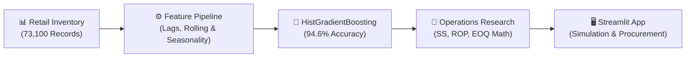

# 📦 AI Demand Forecasting & Dynamic Inventory Optimization

[](https://www.python.org/)
[](https://streamlit.io/)
[](https://scikit-learn.org/)
[](https://powerbi.microsoft.com/)
[]()

An interactive retail supply chain intelligence platform that solves the two biggest inventory challenges: **preventing stockout losses** while **minimizing excess holding capital** through Machine Learning demand forecasting and automated Operations Research math.

---

## ⚡ Quick Start

```bash
# 1. Clone repository
git clone https://github.com/Suniltkumartsk/AI-Based-Demand-Forecasting-and-Inventory-Optimization-.git
cd AI-Based-Demand-Forecasting-and-Inventory-Optimization-

# 2. Install dependencies
pip install -r requirements.txt

# 3. Train models & compute replenishment
python src/train_and_optimize.py

# 4. Launch interactive dashboard
streamlit run app.py
```
> 💡 *Dashboard opens automatically at `http://localhost:8501`.*

---

## 🚀 Live Interactive Dashboard Highlights

The Streamlit web application provides real-time visibility and what-if simulation capabilities:

- 🏬 **Multi-Store Network & Regional Filtering**: Switch between Store Locations (`S001` - `S005`), Regions (`North`, `South`, `East`, `West`), Categories, and individual SKUs.
- 💰 **INR (₹) Financial Tracking**: Real-time evaluation of Realized Revenue, Lost Revenue due to stockouts, and capital required for reorders.
- 📈 **AI vs. Actual Demand Trends**: Interactive Altair line charts tracking daily demand velocity, 7-day rolling trends, and promotional lift.
- ⚙️ **Interactive What-If Simulation Engine**: Adjust Cycle Service Level (90% to 99%) and Supplier Lead Time shocks (±7 days) on the fly to see instant recalculations of Safety Stock and Reorder Points.
- 📥 **One-Click Procurement Export**: Color-coded reorder table (`Healthy`, `Reorder Needed`, `Critical`, `Stockout`) with one-click CSV download for purchase orders.

---

## 🔄 End-to-End Workflow



---

## 📊 Key Performance Benchmarks

| Metric | Baseline Forecast | AI Model (Ours) | Business Impact |
| :--- | :---: | :---: | :--- |
| **Forecast Accuracy** | 93.91% | **94.60%** | Higher predictability on high-velocity days |
| **WAPE (Error %)** | 6.09% | **5.40%** | Lower variance on promotional spikes |
| **MAE (Mean Error)** | 8.32 units | **7.38 units** | Closer replenishment tracking |
| **Forecast Bias** | +5.03 | **+0.048** | Eliminates chronic over-ordering |

---

## 🧮 Inventory Optimization Formulas

Rather than static rule-of-thumb ordering, dynamic parameters are computed using bivariate demand and lead-time uncertainty:

- **Safety Stock ($SS$)**:
  $$SS = Z \times \sqrt{L \cdot \sigma_D^2 + D^2 \cdot \sigma_L^2}$$
  *(Accounts for both daily demand fluctuations and supplier delivery delays)*

- **Reorder Point ($ROP$)**:
  $$ROP = (D \times L) + SS$$
  *(Triggers new replenishment orders automatically)*

- **Economic Order Quantity ($EOQ$)**:
  $$EOQ = \sqrt{\frac{2 \times D_{\text{annual}} \times S}{H}}$$
  *(Minimizes the sum of purchase order fees and holding costs)*

---

## 📂 Project Structure

```text
├── app.py                      # Interactive Streamlit Web Dashboard
├── retail_store_inventory.csv  # Primary multi-store dataset (73,100 rows)
├── data/
│   ├── raw/                    # Cleaned products and sales transactions
│   └── processed/              # Model predictions and inventory parameters
├── src/
│   ├── features.py             # Time-series lags & rolling features
│   ├── inventory.py            # Safety Stock, ROP, and EOQ math
│   ├── train_and_optimize.py   # Model training & optimization pipeline
│   └── generate_data.py        # Dataset preprocessing & ingestion
├── sql/                        # Schema setup & analytical window queries
├── power_bi/                   # DAX formulas & Power BI guide
└── requirements.txt            # Project dependencies
```

---

## 🛠️ Tech Stack

- **Frontend**: Streamlit, Altair Charts, Custom HTML/CSS
- **Modeling & Machine Learning**: Scikit-Learn (`HistGradientBoostingRegressor`), Pandas, NumPy
- **Database & Analytics**: SQL (PostgreSQL Window Functions)
- **Business Intelligence**: Power BI (DAX Measures & Dimensional Modeling)

---

### 📄 License
This project is open-source and available under the [MIT License](LICENSE).
